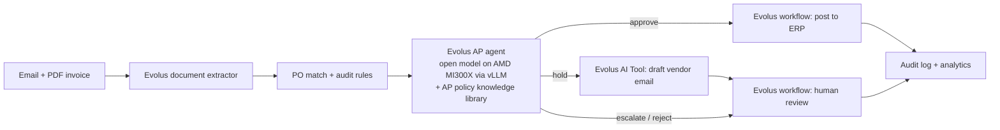

# LedgerHawk: accounts-payable control agent on Evolus × AMD

### ▶ Live demo: **[ledgerhawk-vercel.vercel.app](https://ledgerhawk-vercel.vercel.app)**

Open it and click any email in the inbox to watch the agent read, check and stamp the invoice. The demo runs in simulation mode (see [Going live](#going-live-evolus--amd)). The first visit after a quiet spell can take a few seconds to wake up.

An AI agent that runs supplier-invoice intake end to end: it reads the invoice that arrives by email, matches it against the purchase order and vendor master, decides whether to pay, hold, escalate or reject it, drafts the query to the vendor, and fires the Evolus workflow that posts it to the ERP or routes it to a person. Every decision lands in an audit log with the agent's reasoning, and the analytics view shows the money it stopped.

**Track:** Evolus Business Agents on AMD · AMD Developer Hackathon ACT III

## The problem
AP teams key invoices by hand, about 10–15 minutes each, and still pay duplicates, overcharges and fraudulent bank-detail changes. Business email compromise ("our IBAN has changed") is one of the costliest frauds companies face.

## How it works



| Step | Built on |
|---|---|
| Read the PDF into JSON | Evolus **document extractor** (REST `ask-file`) |
| PO match (two-way: invoice vs PO), duplicate and bank-detail checks | Deterministic rules in `app.py`, so the result is auditable |
| Decide and explain | Evolus **agent** (OpenAI-compatible endpoint) on an **open model served on AMD Developer Cloud with vLLM**, grounded in a **knowledge library** holding `ap_policy.md` |
| Draft the vendor query | Evolus **AI Tool** `email` |
| Act | Evolus **workflows**: `post-to-erp` and `human-review` |

**Guardrail:** the model can be stricter than the rules, never looser. If it approves an invoice with failed checks, the policy decision overrides it and the override is logged.

## Run it

Every Evolus step runs live when its env vars are set and is simulated otherwise, so the app works out of the box.

```bash
pip install -r requirements.txt
python app.py            # http://localhost:8000
python test_app.py       # self-check: the 5 demo invoices land on the right decisions
```

Docker:

```bash
docker build -t ledgerhawk .
docker run -p 8000:8000 --env-file .env ledgerhawk
```

## Deploy on Vercel

The live demo is deployed from the [`vercel-deploy`](../../tree/vercel-deploy) branch. Vercel detects the FastAPI app in `app.py` on its own, so no extra config is needed; `.vercelignore` keeps the pitch materials out of the upload.

```bash
vercel deploy --prod
```

Add the `EVOLUS_*` variables from `.env.example` in the Vercel project settings to switch steps from simulated to live. The ledger is in memory, so each serverless instance starts from the seeded demo data.

## Going live (Evolus + AMD)

1. **Model on AMD.** On AMD Developer Cloud, start an MI300X droplet with the vLLM image and serve a tool-calling model:
   `vllm serve Qwen/Qwen2.5-7B-Instruct --api-key <secret> --enable-auto-tool-choice --tool-call-parser hermes`
2. **Evolus workspace.** Create it from the event link (`app.evolus.ai/join/AMDACT3`). Under models, add an OpenAI-compatible endpoint: base URL `http://<droplet-ip>:8000/v1`, model `Qwen/Qwen2.5-7B-Instruct`, API key `<secret>`. Test the connection.
3. **Knowledge library.** Create one and upload `ap_policy.md`.
4. **AP agent.** Create an agent that uses the AMD model and the library. Put its id in `EVOLUS_AP_AGENT_ID`.
5. **Document extractor.** Create a JSON extractor with these fields: `vendor`, `invoice_number`, `invoice_date`, `po_number`, `iban`, `currency`, `total`, `lines[] {description, quantity, unit_price}`. Put the owning agent id and the extractor id in `EVOLUS_EXTRACTOR_AGENT_ID` and `EVOLUS_EXTRACTOR_ID`.
6. **Workflows.** Create `post-to-erp` and `human-review` (for example, send an email or a Teams message). Put their ids in `EVOLUS_WORKFLOW_POST_ID` and `EVOLUS_WORKFLOW_REVIEW_ID`.
7. Copy `.env.example` to `.env`, fill in the values and restart. The header pills switch from `sim` to `live`. A live call that fails shows a `fallback` chip in the trace with the error.

Never commit `.env`.

## Demo script (2 minutes)

The AP inbox holds five emails, one per scenario:

| Email | What the agent does |
|---|---|
| Northwind NW-2291 | Clean match → approved for payment |
| Orbit OC-3302 "new bank details" | IBAN differs from master → payment stopped as possible fraud; release needs a reason and a call-back |
| Apex AP-5510 "reminder" | Already paid 17 days ago → rejected as a duplicate |
| Helix HX-7781 | Price +10% over PO → hold, drafts the vendor email |
| Brightline BL-0917 | No PO → hold for the requester |

Rehearsing processes the invoices for real, so a second run of the same email is caught as a duplicate. Click **Reset demo data** at the bottom of the Audit view (or `POST /api/reset`) before going on stage.

Then open **Audit analytics**: touchless rate, exposure blocked, hours saved, exceptions by reason, the human review queue and the searchable audit log with CSV export.

## Files
- `app.py`: API, agent pipeline, Evolus client, simulation
- `index.html`: the UI, with no build step
- `ap_policy.md`: policy document for the knowledge library
- `test_app.py`: self-check
- `brand/`: logo mark, small icon (also the favicon) and logo with wordmark
- `submission/`: pitch deck (`deck.pdf`), cover image, demo script and lablab descriptions

## Security and known limitations
- **Fail-closed amounts.** A missing, non-numeric, infinite or negative quantity, price or total escalates the invoice instead of passing the tolerance checks.
- **Duplicate matching ignores formatting.** Invoice numbers and vendor names are compared without case, spaces or punctuation (`AP-5510` matches `ap 5510`).
- **No authentication in this demo.** Anyone who can reach the server can review invoices and call `POST /api/reset`, and the reviewer name is whatever the form sends. Before real use, put the app behind SSO, take the reviewer from the signed-in user, allow only controllers to release escalated invoices, stop people from approving invoices they submitted, and remove `/api/reset`.
- **Not yet checked:** near-duplicates under a different invoice number (same vendor, amount and date), and cumulative invoicing against a PO's ordered value.

## License
MIT. See `LICENSE`.
